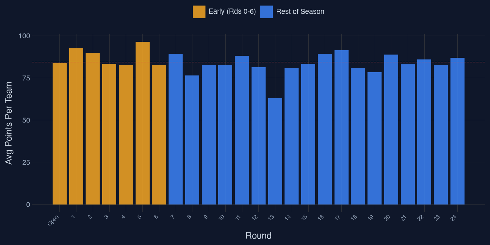
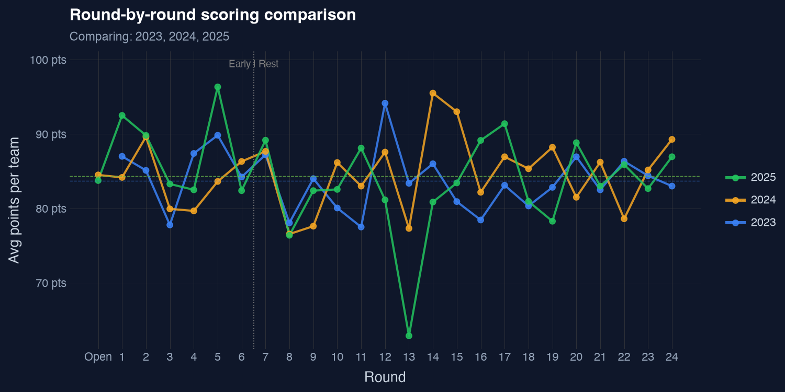

# AFL match data pipeline: R and Python, tested for parity

The data pipeline behind my AFL early-season scoring dashboard (http://benlenepveu.shinyapps.io/afl-scoring-analysis), rebuilt in Python and tested against the original R version. Every output matches R exactly, checked automatically with pytest.

## What the pipeline does

```text
raw AFL Tables results, 2016 to 2025 (fitzRoy)
        │
        ├── keep home-and-away matches (drop finals)
        ├── detect partial Opening Rounds and recode them as Round 0
        ├── add nicknames, scores, margins, winners and season phase
        │
        ├── match_data      one row per match         (1,962 rows)
        ├── round_summary   one row per season round   (230 rows)
        └── phase_summary   one row per season phase   (20 rows)
```

Both versions read the same raw file (`data/raw_results.csv`) and write the same three tables: R to `r_outputs/`, Python to `py_outputs/`.

**Detecting the Opening Round.** AFL Tables labels the Opening Round (introduced in 2024) as "R1", with nothing to tell it apart. The pipeline flags any season whose Round 1 has fewer than 7 games, recodes those games as Round 0, and shifts later rounds down by one. The check looks at Round 1 only, deliberately: bye rounds mid-season also have fewer than 9 games, and a rule applied to every round would mistake them for Opening Rounds.

## How parity is tested

| Test file | What it checks |
| --- | --- |
| `tests/test_parity.py` | Each Python output has the same columns, column order, row count and values as R (relative tolerance 1e-9) |
| `tests/test_pipeline.py` | The tricky logic on small hand-made inputs: finals filtering, Opening Round detection and recoding, draws, summary counts and the 100+ percentage |

```text
11 passed in 0.29s
```

## Charts





## Where R and Python diverged, and how I resolved it

1. **`mutate` sees its own new columns; pandas does not.** In dplyr, `season_phase = ifelse(round <= 6, ...)` uses the `round` recoded earlier in the same `mutate`. My first Python version referred to the raw round column, which silently kept the old values and misclassified matches in the Opening Round seasons. Comparing against R's match table showed the mismatch; pointing the phase at the recoded round fixed it.
2. **`case_when`'s fallback has to be carried over exactly.** R's `round_name` falls back to the original text label ("R1"), not the round number. Translating it with `np.select` meant making the `default` the original label column; my first attempt defaulted to the number.
3. **Missing values never equal each other.** A quick `==` comparison flagged 109 matching rows as different, because `NaN == NaN` is false in pandas (and `NA == NA` gives `NA` in R). `pandas.testing.assert_frame_equal` treats matching missing values as equal, so the parity tests use it.
4. **An average of averages is not an average.** The season average line in both charts first came out slightly wrong because I averaged the round averages. Rounds don't all have the same number of games (the Opening Round has four, bye rounds fewer than nine), so each round needs weighting by its games, or the mean taken across matches directly.
5. **Counting rows the same way.** dplyr's `n()` counts rows. In pandas, `"size"` does the same, but `"count"` skips missing values, so it only matches `n()` when there are none. The summaries use `"size"`.
6. **Converting R's one-line logical means.** `mean(home_score >= 100 | away_score >= 100) * 100` is one line inside `summarise`. In pandas it takes three steps: build a True/False column before grouping, take its mean in the aggregation, and multiply by 100 afterwards.

## Bugs and quirks in the original R code, surfaced by the port

Parity means matching R, quirks included, so Python reproduces all three of these. Each is a candidate for a coordinated fix in both languages, with the tests confirming they stay in sync.

- **A missing nickname.** AFL Tables names the Western Bulldogs "Footscray", but the nickname lookup only covered "Western Bulldogs". Every Bulldogs match since 2016 has had a blank nickname, in the dashboard too.
- **Two labels for one phase.** The match table labels the later phase "Mid/Late Season", while the summaries call it "Rest of Season".
- **A hand-maintained reference file.** The dashboard drew its average lines from a hand-compiled file of yearly averages. This project calculates them from the match data instead, so the whole pipeline runs from one raw input.

## What I would do differently

Check the raw data's team names against the lookup tables when the data loads, so a name like "Footscray" fails loudly instead of quietly producing blanks. I would also add type hints to the pipeline functions, so the expected inputs and outputs are documented in the code itself.

## Run it

```bash
git clone git@github.com:benlenep/afl-data-pipeline-r-to-python.git
cd afl-data-pipeline-r-to-python
uv sync
uv run python python/pipeline.py   # writes py_outputs/
uv run python python/charts.py     # writes charts/
uv run pytest -v                   # parity and unit tests
```

To regenerate the R side: `Rscript r/pipeline.R` (needs dplyr). To refresh the raw data: `Rscript r/export_raw.R` (needs fitzRoy).

## Files

```text
data/raw_results.csv      raw AFL Tables export, read by both pipelines
r/export_raw.R            one-off fitzRoy download
r/pipeline.R              the R pipeline
r_outputs/                R results, committed so the tests can run anywhere
python/pipeline.py        the Python pipeline
python/charts.py          plotnine charts
tests/                    parity and unit tests
charts/                   chart images used above
```

## Data

Match results from [AFL Tables](https://afltables.com) via the [fitzRoy](https://github.com/jimmyday12/fitzRoy) R package.